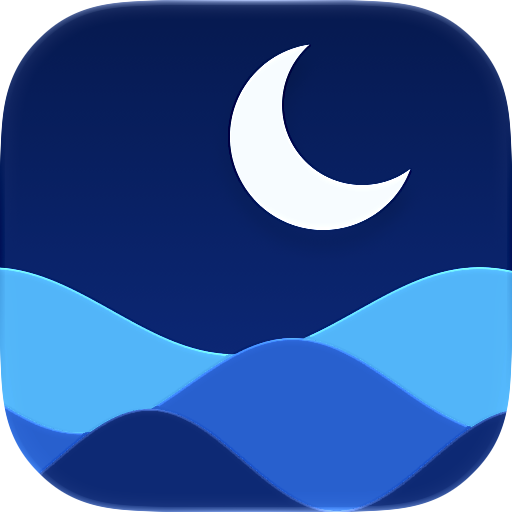
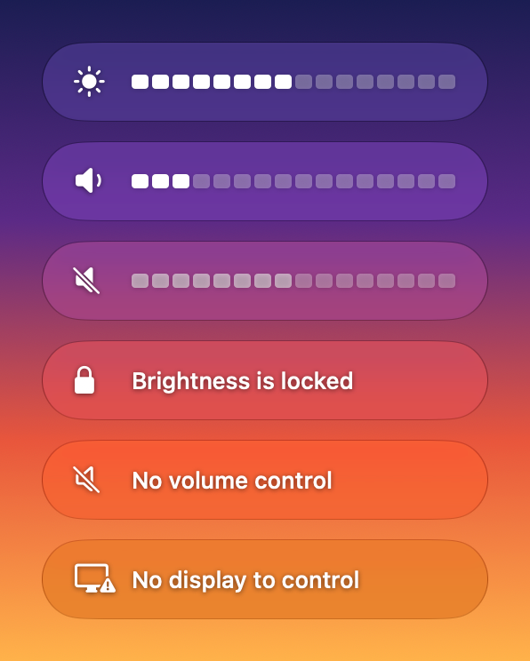

# Hushglow



A macOS menu bar app that controls the brightness, volume and mute of external displays over
DDC/CI.

- The keyboard's brightness, volume and mute keys, or shortcuts of your choice
- An on-screen indicator for each change
- Menu bar sliders per display, with contrast and input selection where the display has them
- Several displays: the keys change the one under the pointer, or all of them
- Dimming below the display's lowest brightness
- Scrolling over the menu bar icon changes brightness
- A command line for scripts
- Updates through Sparkle

Requires an Apple silicon Mac with macOS 26 or later, and a display with DDC/CI switched on.
HDMI works on some Macs only.

To install, download the latest [release](https://github.com/MeoAnderso/Hushglow/releases/latest),
unzip it and move Hushglow to Applications. It is not notarized yet, so macOS refuses to open
it at first: in System Settings → Privacy & Security, choose Open Anyway. You can also build
it from source (see [Build and install](#build-and-install)).



## Using it

| Action | Shortcut | With Rectangle or Magnet installed |
|---|---|---|
| Brightness up / down | `Ctrl+Alt+Up` / `Ctrl+Alt+Down` | `Ctrl+Alt+F2` / `Ctrl+Alt+F1` |
| Volume up / down | `Ctrl+Alt+Right` / `Ctrl+Alt+Left` | `Ctrl+Alt+F12` / `Ctrl+Alt+F11` |
| Mute | `Ctrl+Alt+End` | `Ctrl+Alt+F10` |

Rectangle and Magnet use Ctrl+Alt with the arrows themselves, and macOS lets both apps take
the same keys without telling either, so when one of them is installed a new install starts
on the function keys instead, where Apple's keyboards have these functions. On an Apple
keyboard whose top row sends brightness and volume, hold fn with them. The choice is made
once, the first time the app runs; Restore Defaults in Settings makes it again.

Holding a shortcut keeps stepping, at the pace of the keyboard's own key repeat (System
Settings → Keyboard). Scrolling over the menu bar icon changes the brightness. The menu bar
item has sliders with a mute button for the mouse, which also move when you scroll over
them, and an indicator appears under it as you change a level. With "Play feedback when
volume is changed" on in System Settings → Sound, the volume keys and shortcuts play macOS's
feedback sound. The indicator also tells you when there is nothing to control, and when the
display refuses a change (some picture modes lock brightness).

With more than one display that answers DDC, the menu has a group of rows for each, under
its name, and the keys and shortcuts change the display under the pointer; the volume keys
change the display that sound plays through. The indicator appears on the display that
changed. Settings → General can have the keys change every display at once instead. A
display that has contrast gets a slider for it, and one that reports its input gets its
inputs in a submenu, to switch it to another source. Two displays of one model that report
no serial number, or the same one, cannot be told apart: the menu numbers their names, the
keys change both, and neither is dimmed below its lowest brightness.

A keyboard's own volume and brightness keys work too, if it has them and macOS receives
them. That needs the app to be switched on in System Settings → Privacy & Security, in the
list macOS 27 calls Device Control and Data Access and macOS 26 calls Accessibility.
The app walks you there; the shortcuts, the menu and the command line work without it.

### Settings

Choose Settings… in the menu. Esc or Cmd-W closes the window.

- **Indicator.** Its style is Glass (the system's Liquid Glass, which follows the Liquid Glass
  setting in System Settings → Appearance), See-through glass (the same at reduced strength,
  so what is behind shows through) or Plain tint (no blur at all). It can appear under the
  menu bar icon or in the top-right corner, and can show the level as a percentage.
- **Shortcuts.** Click a field, or focus it and press Space, then press the keys. A shortcut
  is any of Ctrl, Alt, Shift and Cmd with an arrow, page, Home, End or function key; a
  function key can also stand alone. The field shows the modifiers as you hold them. Delete
  removes a shortcut; so does the ✕ beside the field, and the arrow beside it puts back the
  default. Both show while the pointer is over the field or the field has the focus. The
  window says why when a shortcut cannot be used. The app's shortcuts are paused only while a field is waiting for
  keys, so that what you press is taken down and not acted on. Keys that macOS has a
  shortcut of its own on, such as Ctrl+Up for Mission Control, are turned down with a note
  saying so; to use them, switch macOS's shortcut off in System Settings → Keyboard →
  Keyboard Shortcuts. "Quarter steps" registers each stepping shortcut a second time with a
  modifier added, Cmd unless you choose another, for steps a quarter of the size. It is off by
  default. Shift is a poor choice with the default shortcuts, since macOS uses
  Ctrl+Alt+Shift+arrows itself; the window names any that clash.
- **Brightness and volume keys**, the keyboard's own. Shows whether they are on, and turns
  them on.
- **Keys change** the display under the pointer, or every display; this matters only with
  more than one display that answers DDC.
- **Dim the screen below the display's lowest brightness.** On by default: once a display is
  at its lowest, the brightness keys go on darkening its screen, in six steps of a tenth,
  with a black layer over it that clicks go through and screenshots leave out. Brightness up
  takes it off first, and so does moving the slider.
- **Launch at login.**
- **Check for updates automatically**, in a build that can update itself (see Updates).

The indicator follows the system's accessibility settings: a solid capsule with Reduce
Transparency, a strong outline with Increase Contrast, and no movement with Reduce Motion.
VoiceOver is told the new level once it settles.

Shortcuts can also be set from the command line:

```bash
Hushglow shortcut                            # list
Hushglow shortcut volume-up ctrl+alt+right   # set
Hushglow shortcut mute none                  # remove
Hushglow shortcut brightness-up default      # reset
Hushglow shortcut quarter-steps on           # or off, or cmd, shift, alt or ctrl
```

Actions are `brightness-up`, `brightness-down`, `volume-up`, `volume-down` and `mute`. The
command reports whether the running app could register the shortcut.

### Updates

Hushglow looks for a new release of this repository once a day, if you say yes when it asks
on its second launch, and its menu has Check for Updates…. The updater is
[Sparkle](https://sparkle-project.org). Each update is signed with a key only the maintainer
holds, and the app installs only what that key signed; the public half is `SUPublicEDKey` in
`Resources/Info.plist`. A fork that publishes updates of its own replaces it there, with the
feed address beside it.

### Scripts

```bash
Hushglow step brightness up      # or down; add --fine for a quarter step
Hushglow set volume 30           # percent
Hushglow mute                    # toggle; or: mute on, mute off
Hushglow set brightness 70 --display 2   # one display, numbered as status lists them
Hushglow set contrast 60
Hushglow input hdmi1             # or dp1, dp2, hdmi2, usbc: the display then shows that input
Hushglow get brightness
```

`Hushglow` here is `/Applications/Hushglow.app/Contents/MacOS/Hushglow`, and
`Hushglow help` lists every command. A command it does not know gets the same list and
does not start the app. While the app is running these commands go through it, `get`
included, so that only one program talks to the display at a time. The running app answers
its own command line only: the one inside the same app, or from a build signed with the same
certificate. Another build of the app, such as one run from `.build`, is turned down. That keeps
builds apart; it does not keep your other programs out, since any of them can run the command
line too.

### When something does not respond

- `Hushglow status` shows what the running app sees: its version and build, the display's
  values, how much memory the app uses, whether the keyboard's own keys are active, which
  shortcuts are registered, and how many key presses it has received and what the last one
  was.
- `Hushglow watch-keys` shows, for ten seconds, which special keys reach the app. Use it
  to find out what a keyboard's volume keys actually send. Ordinary typing is not recorded,
  and the indicator says on screen that a watch is running for as long as it runs.
- `Hushglow doctor` checks the connection to the display, through the app while it runs.
  `--write-test` also changes brightness and volume by one unit and restores them, once the
  app has been quit, since only one program may talk to the display at a time; `--key-test`
  sends a simulated volume key through the system to prove that such keys reach the app.
- For a live trace of every key and shortcut the app receives:
  `log stream --level debug --predicate 'subsystem == "io.github.meoanderso.Hushglow"'`

## Build and install

```bash
Scripts/install.sh       # builds, installs into /Applications and starts the app
Scripts/build-app.sh     # only builds build/Hushglow.app
Scripts/release.sh       # also packs and signs it for an update, and writes the feed; --publish releases it
swift test               # unit tests
swift format lint --strict --recursive Sources Tests Scripts Package.swift
```

The app runs on macOS 26 or later. Building it requires Xcode's Swift 6.2 toolchain or
later. The one third-party dependency is Sparkle, the updater, which Swift Package Manager
fetches at an exact version.

Every build runs with the hardened runtime. With a Developer ID certificate, the build script
also has Apple notarize the app and staples the ticket to it:

```bash
CODESIGN_IDENTITY="Developer ID Application: <name> (<team>)" NOTARY_PROFILE=<profile> Scripts/build-app.sh
```

The profile holds the notarization credentials in the keychain; create it once with
`xcrun notarytool store-credentials <profile>`.

Every push to GitHub is built without warnings, the tests included, then tested, linted and
built into the app by [continuous integration](.github/workflows/ci.yml).

The tests that put windows and a menu on screen run only with `PREVIEW_DIR` set to a folder,
and are reported as skipped otherwise, continuous integration included; they are left to a
person. They write pictures of the indicator, the menu, Settings, the notices and the helper
to that folder, and check what can only be seen on screen: the shortcuts and a drag in the
open menu, the indicator leaving while the menu is open, and its movement. That puts windows
and a menu on screen for a few seconds.

### Turning on the brightness and volume keys, and again after a rebuild

Choosing "Turn On Brightness and Volume Keys…" opens that list in System Settings and puts a small helper
under the window with the app's icon. Drag the icon into the list and the keys work. The
helper's "?" button offers "Add Without Dragging", which has macOS ask with its own alert
and add the app switched off.

macOS ties this access to the app's signature. Without a signing certificate every rebuild
looks like a different app: System Settings still shows the switch as on, but macOS ignores
it. The app handles this itself. The first time a new build runs without access, it explains
what happened, and "Turn On Brightness and Volume Keys…" first clears the stale entry, so
the list is ready for the app to be dragged in again. The menu and Settings offer the same at
any time, and unticking "Ask again after updates", in that notice or in Settings, stops new
builds from raising it. A build signed with a certificate keeps its access across updates
signed with the same certificate, and raises the subject only when the certificate changes.

To skip even that, create a signing certificate once: in Keychain Access choose
Certificate Assistant → Create a Certificate, name it `Hushglow Dev`, with Identity Type
Self-Signed Root and Certificate Type Code Signing. The build script uses a certificate with
that name automatically, and `CODESIGN_IDENTITY` selects another one.

### Releasing

Once, create the update key and give the app its public half:

```bash
.build/artifacts/sparkle/Sparkle/bin/generate_keys
```

It keeps the private key in your login keychain and prints the public key; put that in
`Resources/Info.plist` as `SUPublicEDKey`. Keep a copy of the private key somewhere safe
(`generate_keys -x <file>` exports it): without it no installed copy can be updated again.

For each release, raise `CFBundleShortVersionString` and `CFBundleVersion` in
`Resources/Info.plist`, commit, and run `Scripts/release.sh`. It builds the app, signs the
archive with the key from the keychain and writes `build/appcast.xml`; `--publish` then
creates the release on GitHub with both files, and the app's feed address points at the
latest release. Until the app is notarized, macOS refuses to open a downloaded copy at first;
in System Settings → Privacy & Security, choose Open Anyway.

### Translating

Every word the app shows comes from `Resources/Localizable.xcstrings`, a string catalog in
which English is the source; Xcode edits one, and so does any editor, being JSON. Add a
language there and `Scripts/build-app.sh` builds it in. After changing text in the code, run
`Scripts/strings.sh`, which brings the catalog up to date; continuous integration checks that
it was. The names of System Settings' lists and of macOS's keys should be the ones macOS uses
in that language. The command line's own messages stay in English.

### Uninstalling

Quit the app, turn off Launch at Login, delete `/Applications/Hushglow.app`, remove it
from that list in System Settings, and run `defaults delete io.github.meoanderso.Hushglow`.

## Licence

MIT. See [LICENSE](LICENSE). The app includes [Sparkle](https://sparkle-project.org) under
its own licence, which comes with the app as `Contents/Resources/Acknowledgements.txt`.
